# Report figures

Each image is a standalone panel. CSV tables contain its plotted values.

## 01_baselines

QD=1 baselines. Medians and trial IQR; p95/p99 are per-trial request percentiles.

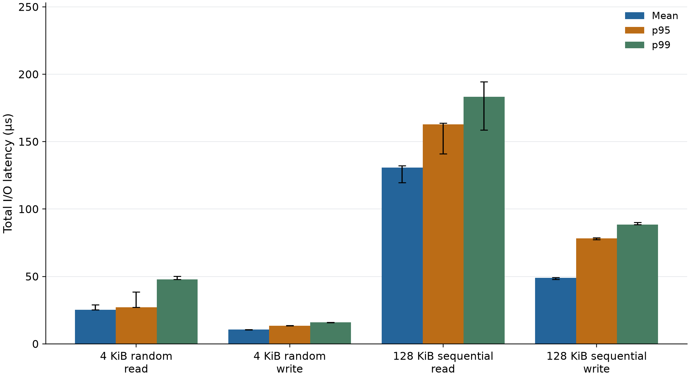

[Plotted data](tables/01_baselines.csv)

## 02_block_iops

Block-size comparison from the same trials; QD 16, one job, 1 GiB file range.

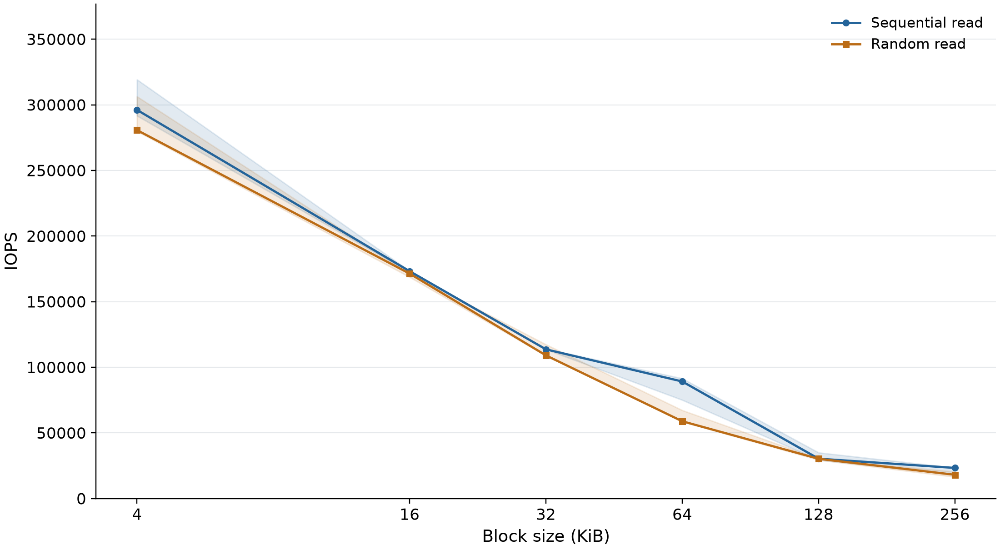

[Plotted data](tables/02_block_iops.csv)

## 02_block_mib_s

Block-size comparison from the same trials; QD 16, one job, 1 GiB file range.

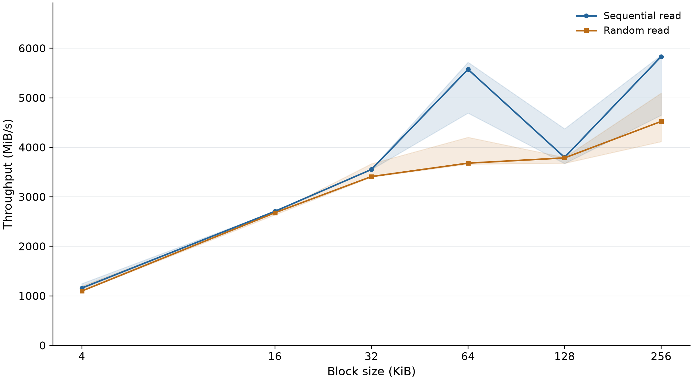

[Plotted data](tables/02_block_mib_s.csv)

## 02_block_lat_us

Block-size comparison from the same trials; QD 16, one job, 1 GiB file range.

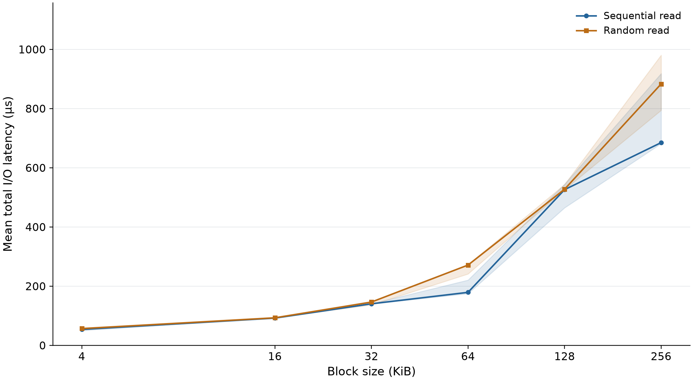

[Plotted data](tables/02_block_lat_us.csv)

## 03_mix_iops

Read/write mixes 100/0, 70/30, 50/50, 0/100; QD 16. Mixed mean latency is weighted by completed I/O counts.

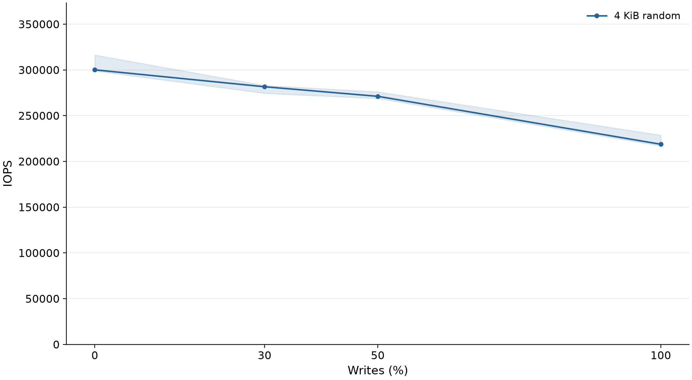

[Plotted data](tables/03_mix_iops.csv)

## 03_mix_lat_us

Read/write mixes 100/0, 70/30, 50/50, 0/100; QD 16. Mixed mean latency is weighted by completed I/O counts.

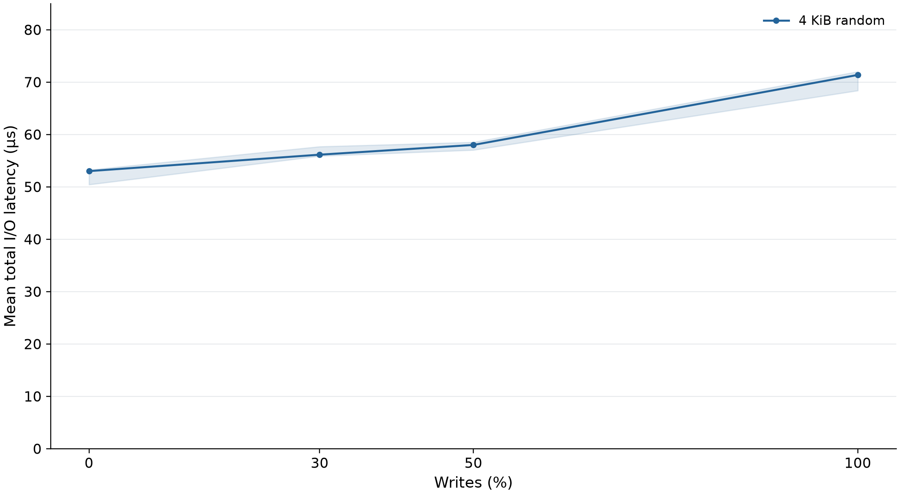

[Plotted data](tables/03_mix_lat_us.csv)

## 04_queue_throughput_latency

* marks the first QD reaching 90% of observed peak IOPS, an operational near-knee estimate, not proof of saturation. 4 KiB random reads; one job.

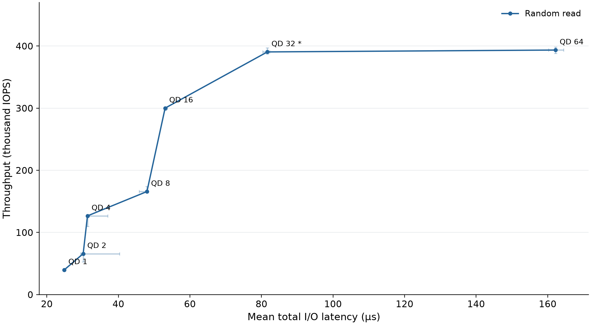

[Plotted data](tables/04_queue_throughput_latency.csv)

## 05_tail_latency

Median and trial IQR of per-trial percentiles, not pooled request quantiles. 4 KiB random reads.

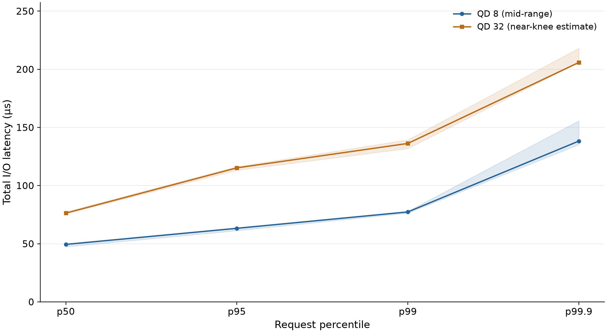

[Plotted data](tables/05_tail_latency.csv)

## 06_range_latency

4 KiB random reads at QD 16. File offset ranges do not establish physical LBA placement.

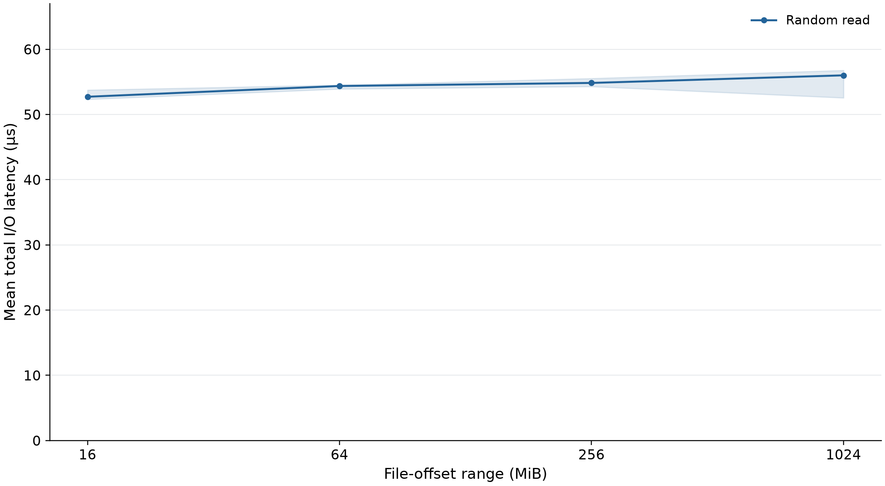

[Plotted data](tables/06_range_latency.csv)

## 07_state_throughput

Single bounded 128 KiB sequential-write burst at QD 16; nominal one-second windows, with any short final window labeled. No repeatability interval or steady-state claim.

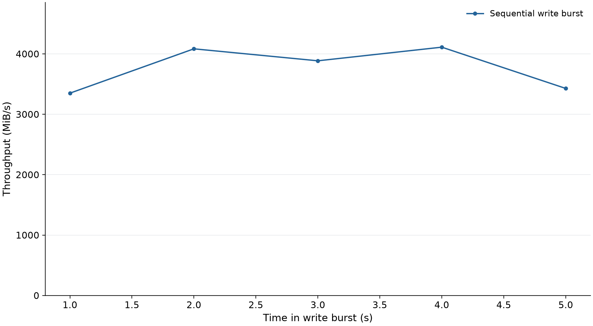

[Plotted data](tables/07_state_throughput.csv)

## 07_state_latency

Single bounded 128 KiB sequential-write burst at QD 16; nominal one-second windows, with any short final window labeled. No repeatability interval or steady-state claim.

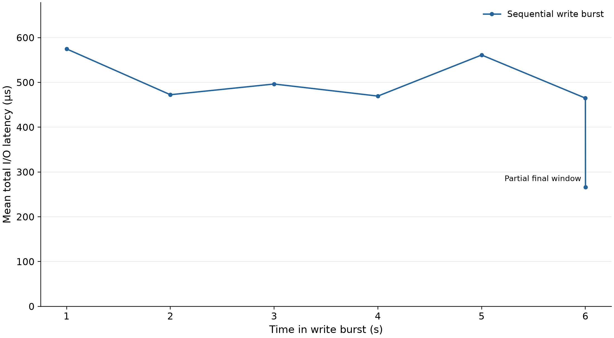

[Plotted data](tables/07_state_latency.csv)

## 08_page_cache_pitfall

Repeated 16 MiB reads, 128 KiB blocks, QD 1. Direct I/O bypasses the OS page cache, not SSD controller caches.

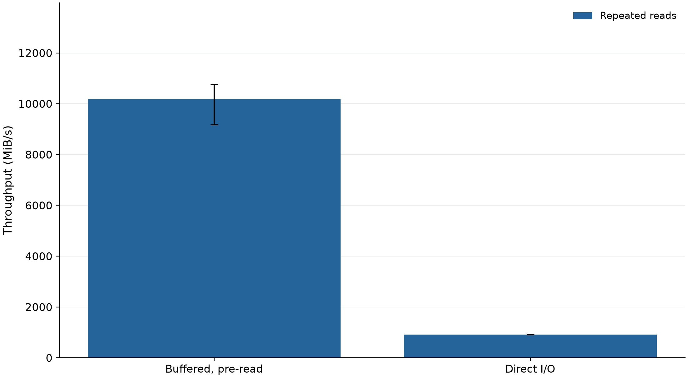

[Plotted data](tables/08_page_cache_pitfall.csv)
