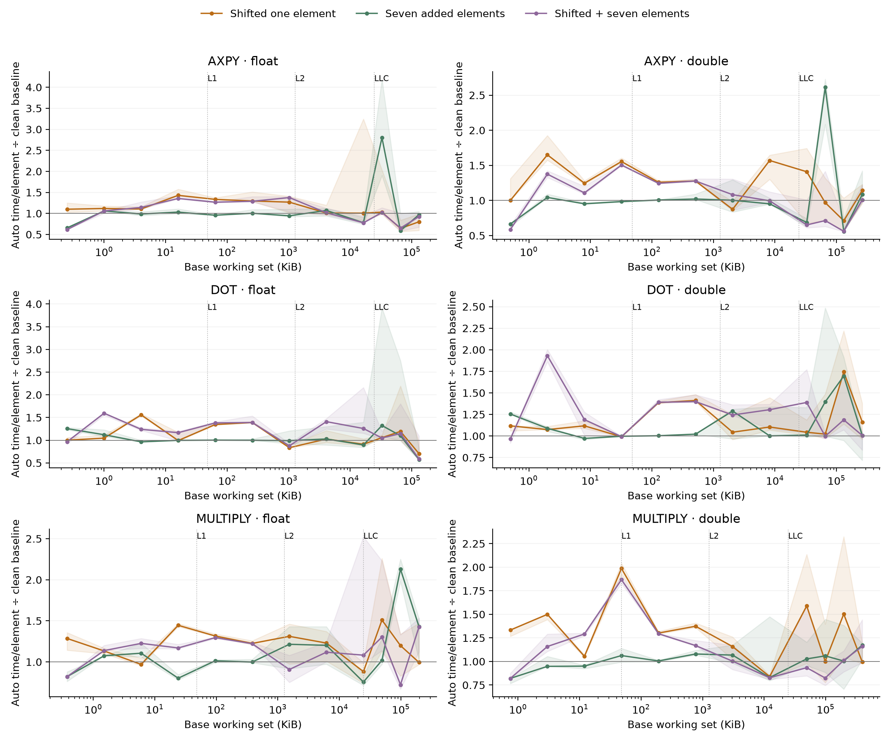
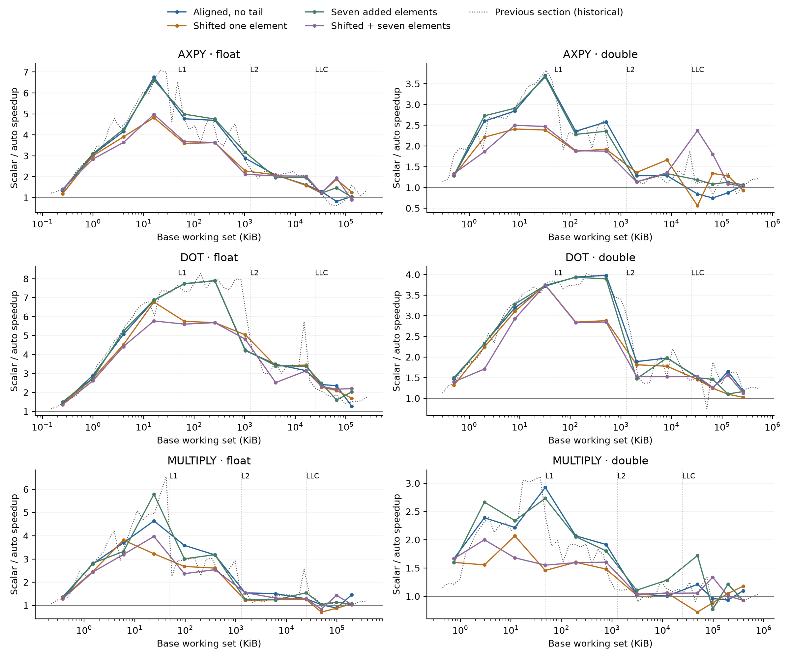

# Working-set alignment and tail comparison

8640 validated measurements: 3 kernels × 2 precisions × 12 base sizes × 4 conditions × 2 builds × 15 trials. Five warmups; one timed call; CPU 0. Matched compiler flags and original input sequence.

The clean baseline uses 64-byte alignment and lengths divisible by eight. Shifted cases move every array one element (4 bytes for float, 8 for double). Tail cases add seven elements: remainder seven for float and three for double under 256-bit AVX. Combined cases apply both. Time per element accounts for the extra work.

The historical series is the actual previous-section data, plotted at its original sizes. Those allocations were not consistently 64-byte aligned and their lengths often already had tails. Consequently, only the new matched comparisons isolate these changes; historical differences also include allocation, run-to-run variation and different sizes.

Shading in the cost plot is the case timing IQR divided by the clean median; it is not a confidence interval and does not include uncertainty in that denominator. Cache lines mark nominal capacities. Base working set counts two arrays for AXPY/dot and three for multiplication; an AXPY reset source is outside the timed kernel but can affect cache state. Tiny single-call measurements are timer/call-overhead sensitive.

## Measured changes

Ranges below summarize medians across tested sizes; positive values mean slower auto-vectorized time per element.

### axpy, float

- Shifted one element: -35.6% to +43.0%; large-size median -19.9%.

- Seven added elements: -40.9% to +180.3%; large-size median -3.0%.

- Shifted + seven elements: -38.5% to +37.7%; large-size median -7.5%.

### axpy, double

- Shifted one element: -28.9% to +65.0%; large-size median -3.2%.

- Seven added elements: -44.0% to +161.2%; large-size median +8.5%.

- Shifted + seven elements: -43.9% to +50.4%; large-size median -28.7%.

### dot, float

- Shifted one element: -29.6% to +55.8%; large-size median +5.5%.

- Seven added elements: -42.6% to +32.3%; large-size median +9.9%.

- Shifted + seven elements: -41.1% to +59.5%; large-size median +4.8%.

### dot, double

- Shifted one element: -0.9% to +74.3%; large-size median +16.1%.

- Seven added elements: -2.8% to +69.5%; large-size median +39.5%.

- Shifted + seven elements: -3.5% to +93.1%; large-size median +0.6%.

### multiply, float

- Shifted one element: -11.8% to +50.9%; large-size median +19.9%.

- Seven added elements: -24.5% to +112.9%; large-size median +42.8%.

- Shifted + seven elements: -27.8% to +42.6%; large-size median +30.2%.

### multiply, double

- Shifted one element: -16.0% to +98.7%; large-size median +0.2%.

- Seven added elements: -17.9% to +17.3%; large-size median +5.9%.

- Shifted + seven elements: -17.9% to +86.8%; large-size median +1.2%.

## Interpretation limits

A tail-case difference is a whole-loop effect, not a direct measurement of cleanup instructions. Small effects comparable to trial variability should not be assigned to tails. Changing N can alter compiler paths and cache placement; no cold-cache behavior is inferred. All observations are retained. No new result replaces the previous figures.
## Independent confirmation

840 additional validated observations.

axpy double, N=32768, tail=0, shift=1: +9.8% auto time/element versus confirmation baseline.

axpy double, N=32768, tail=7, shift=0: +5.8% auto time/element versus confirmation baseline.

axpy double, N=32768, tail=7, shift=1: +6.8% auto time/element versus confirmation baseline.

axpy double, N=4194304, tail=7, shift=0: -18.6% auto time/element versus confirmation baseline.

axpy float, N=32768, tail=0, shift=1: +27.6% auto time/element versus confirmation baseline.

axpy float, N=32768, tail=7, shift=0: +0.2% auto time/element versus confirmation baseline.

axpy float, N=32768, tail=7, shift=1: +28.9% auto time/element versus confirmation baseline.

axpy float, N=4194304, tail=7, shift=0: -10.5% auto time/element versus confirmation baseline.

dot double, N=16777216, tail=0, shift=1: -26.7% auto time/element versus confirmation baseline.

dot double, N=16777216, tail=7, shift=0: -0.1% auto time/element versus confirmation baseline.

dot double, N=16777216, tail=7, shift=1: -26.8% auto time/element versus confirmation baseline.

dot float, N=16777216, tail=0, shift=1: +7.9% auto time/element versus confirmation baseline.

dot float, N=16777216, tail=7, shift=0: +1.7% auto time/element versus confirmation baseline.

dot float, N=16777216, tail=7, shift=1: -7.5% auto time/element versus confirmation baseline.

multiply double, N=8388608, tail=0, shift=1: +14.7% auto time/element versus confirmation baseline.

multiply double, N=8388608, tail=7, shift=0: +14.0% auto time/element versus confirmation baseline.

multiply double, N=8388608, tail=7, shift=1: +1.9% auto time/element versus confirmation baseline.

multiply float, N=8388608, tail=0, shift=1: +4.2% auto time/element versus confirmation baseline.

multiply float, N=8388608, tail=7, shift=0: +19.0% auto time/element versus confirmation baseline.

multiply float, N=8388608, tail=7, shift=1: +33.6% auto time/element versus confirmation baseline.