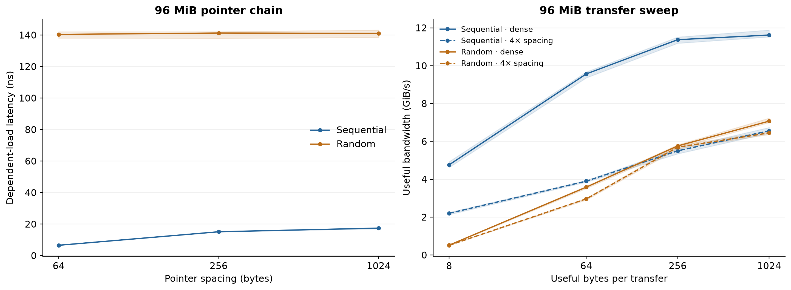
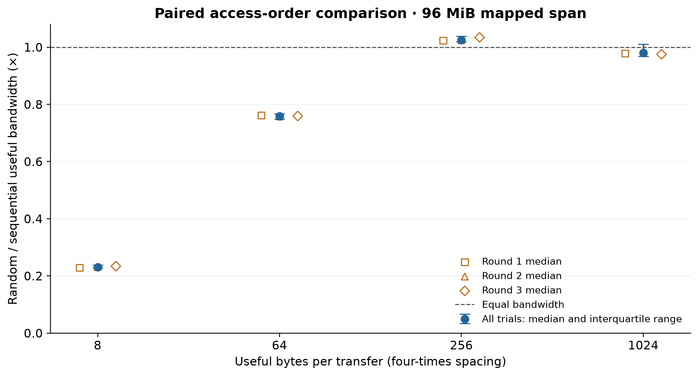

# Pattern and granularity follow-up

990 validated fresh-process measurements: 3 rounds × 15 trials × 22 conditions. Each timed interval targets 250 ms. Every trial retains the pilot’s full warm traversal/pass. CPU 0. All samples retained.

Sequential and random orders are adjacent pairs, with alternating order and shuffled condition groups. Bands show the middle half of observations, not confidence intervals. Separate round medians expose run-to-run drift.

## Four-times spacing

| Transfer bytes | Sequential GiB/s | Random GiB/s | Median paired random/sequential | Paired IQR | Round medians |
|---:|---:|---:|---:|---:|---|
| 8 | 2.201 | 0.509 | 0.231× | 0.228–0.239× | 0.229×, 0.231×, 0.234× |
| 64 | 3.900 | 2.963 | 0.759× | 0.749–0.768× | 0.762×, 0.758×, 0.759× |
| 256 | 5.502 | 5.692 | 1.026× | 1.019–1.039× | 1.023×, 1.024×, 1.034× |
| 1024 | 6.558 | 6.448 | 0.980× | 0.968–1.011× | 0.978×, 0.984×, 0.975× |

## Interpretation limits

The kernel and benchmark cases are unchanged. Trial duration and acquisition schedule differ from the pilot, so differences between campaigns cannot isolate a hardware mechanism. At four-times spacing, blocks of at least 64 bytes touch about 24 MiB of payload cache lines within the 96 MiB mapped span, plus the access-order array. Repeated passes can reuse cache contents. The 8-byte case uses 32-byte spacing and touches more cache-line bytes than its payload.

Hardware counters available on all measurements: False. No CPU-frequency or background-load controls were changed. Timing alone cannot identify prefetch or cache-set effects.

## Reproduction

`python3 scripts/repeat_pattern.py` then `../.venv-analysis/bin/python scripts/analyze_pattern_repeat.py`. Acquisition sources, commands, raw observations, summaries, and raw-data hash are retained in this run. The original pilot and its latest-run marker are unchanged.